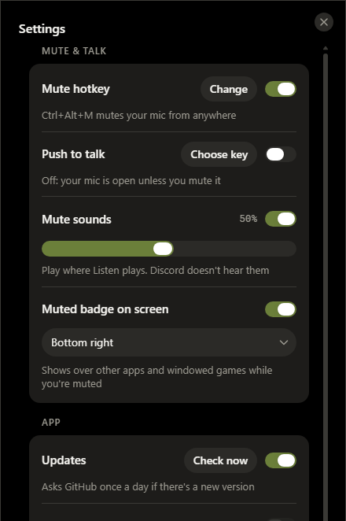

<p align="center"></p>
<h1 align="center">Olive</h1>
<p align="center">A microphone manager for Windows, inspired by SteelSeries Sonar's mic tab.</p>
<p align="center"><a href="https://github.com/Zaytoonic/Olive/releases/latest"><strong>Download the latest version</strong></a></p>
<p align="center">
  <a href="https://github.com/Zaytoonic/Olive/releases/latest"></a>
  
  <a href="LICENSE"></a>
</p>


## Features


- **Voice cleanup:** RNNoise noise reduction with adjustable strength, and a noise gate that opens on your voice.
- **Compressor** to even out your volume.
- **Six-band EQ** with a low cut and presets, saved separately for each mic, and a hold-to-compare button.
- **Send to Discord or other apps** through [VB-Audio Virtual Cable](https://vb-audio.com/Cable/).
- **Windows mic volume and mute**, with a mute hotkey that works from anywhere, a short sound when you mute or unmute (with its own volume), and an optional **Muted** badge in a corner of the screen.
- **Push to talk** on any key or side mouse button.
- **Listen** to hear your processed mic live, on the output device you choose.
- **Test mic** records 5 seconds of exactly what Olive sends to Discord, then plays it back to you.
- **Runs in the tray**, can start with Windows, and updates itself in one click.
- **Settings** you set once (hotkeys, push to talk, mute sounds, the badge, updates) live behind the gear, out of the way. A dot on the gear tells you when something there needs you.

<br clear="right">

## Installing
Download `Olive-Setup-<version>.exe` from [Releases](https://github.com/Zaytoonic/Olive/releases/latest) and run it. It installs for your Windows account, with no admin rights needed, and adds a Start menu shortcut and an uninstaller. The app is not code-signed yet, so Windows may say "Windows protected your PC": click **More info**, then **Run anyway**.

Olive checks GitHub once a day for a new version, and the gear shows a dot when there is one. To update, open **Settings → Updates** and click **Install**; you can also turn the daily check off there. Nothing is downloaded until you click **Install**. Olive then downloads the new installer and checks it against the release's SHA-256 checksum before running it. It closes for a few seconds while the update installs, then opens again.

## Using it with Discord
1. Install [VB-Audio Virtual Cable](https://vb-audio.com/Cable/) and restart your PC.
2. In Olive, choose your mic and leave **Send to Discord / other apps** on.
3. In Discord, open **Voice & Video** and set the input device to **CABLE Output**.

## Building from source
You need Windows and [Node.js](https://nodejs.org/).
```
npm install
npm run update-runtime
npm run build
npm run patch-exe
```
The app is then at `dist\Olive\Olive.exe`. Keep it in its folder. Closing the window hides it to the tray; to quit, right-click the tray icon.

To run it from source instead, use `npm start`.

To build the installer, run `npm run installer`, which creates `dist\Olive-Setup-<version>.exe`. `npm run test:installer` tests it end to end, including an update from inside Olive, kept apart from your real install. To code-sign it, see the top of `tools/sign.js`.

## After changing the code
Quit Olive first, because `npm run build` won't run while it's open.
1. `npm run build` copies `src` and `assets` into `dist/Olive/resources/app`.
2. `npm run patch-exe` is only needed if the icon or version changed.
3. `npm run test:audio` measures the audio chain on a fake mic, in a hidden copy with its own settings. It takes about 4 minutes.

After changing Electron's version, run `npm run update-runtime` before these steps.

## Project layout
```
src/main/        Electron main process
  main.js          window, tray, muted badge, start with Windows, updates, app:// for the audio worklets
  migrate.js       moves settings and the login entry from when the app was called Mic Manager
  updates.js       asks GitHub whether a newer version exists, and downloads and checks its installer
  preload.js       safe bridge between the window and main.js
  sysmic-client.js runs the Windows audio helper and talks to it
  win-audio.cs     Windows Core Audio helper: list mics, set volume and mute, report the ASUS mic key
  win-audio.ps1    runs that helper through PowerShell if win-audio.exe is missing
src/ui/          the window, in React with HeroUI v3 (npm run build:ui builds it into src/renderer/ui)
  store.js         everything the window does: settings, Windows mic control, hotkeys, push to talk, updates
  App.jsx, Settings.jsx, Equalizer.jsx, bits.jsx   the components
  eq-model.js, eq-graph.js   the EQ's bands and its canvas graph
  olive.css        Olive's palette on HeroUI's theme, and the meters
src/renderer/    what the window page loads
  index.html       loads the audio engine, then the window (ui/, built from src/ui)
  audio-engine.js  the audio chain: mic capture, noise reduction, EQ, gate, compressor, Listen and the cable. It never touches the page, so a new window can drive it the same way
  badge.html, badge.css  the Muted badge
  voice-worklet.js noise reduction (RNNoise) and the voice gate
  gate-worklet.js  volume gate, for a gate set by hand or as the fallback
  nr-worklet.js    fallback noise reduction, if the voice engine can't start
  recorder-worklet.js  records the mic test
  vendor/          RNNoise (xiph, Feb 2025 model) compiled to WebAssembly, from @shiguredo/rnnoise-wasm 2025.1.5
assets/          icons and mute sounds, both made from code (tools/make-icons.js, tools/make-sounds.js)
docs/            the screenshots above
tools/           build, packaging, signing, icon and sound scripts
  audio-test/      npm run test:audio
  installer/       the installer and uninstaller source, and npm run test:installer
```

The palette and icon are described in [DESIGN.md](DESIGN.md).

## Licence
Olive is released under the [MIT licence](LICENSE): you can use, change and share it, as long as the copyright notice stays with it. The bundled RNNoise build in `src/renderer/vendor` keeps its own licences (RNNoise: BSD; the WebAssembly build: Apache-2.0), in `rnnoise-LICENSE.txt`.
